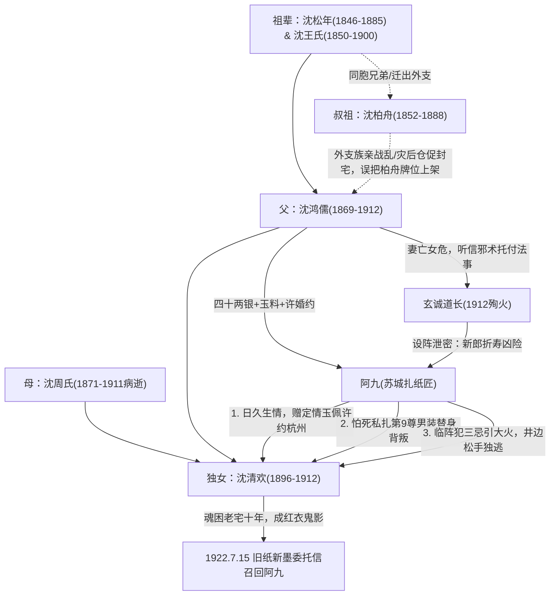

# 《沈家老宅》完整故事线与文案重构方案

> **适用版本**：Godot 4.7 Forward+ 工程（对应 `autoload/ItemDB.gd`、`scripts/main.gd`、`scripts/world/WorldBuilder.gd`、`scripts/world/Endings.gd` 等现行实现）  
> **文档性质**：剧情逻辑统一与游戏内文案落地指导手册（可直接用于替换/校对游戏内 12 份文档、9 件道具、组合台词及结局演出文本）

---

## 1. 文档定位与修订总览

### 1.1 一句话核心故事（Logline）

> **十年前的中元夜，贪生怕死的苏城扎纸匠阿九接下沈家的“借命冥婚”邪阵，既骗了爱慕自己的病弱小姐沈清欢，又因畏死私造替身、临阵犯忌酿成灭门大火，并在火场生死关头松手独逃、撞伤失忆；十年后的同一个中元暴雨夜，沈家冤魂寄出一封旧纸新墨的委托信，将他“请”回老宅，只为讨一个迟到十年的了断。**

### 1.2 原版文案六大逻辑矛盾修复对照表

原版 `autoload/ItemDB.gd` 与 `docs/GDD_沈家老宅.md` 在碎片文档、道具线索和终局玩法之间存在六处明显冲突，导致玩家读完文档容易前后混乱。本方案在不破坏现有代码骨架的前提下，逐项梳理并彻底解决如下：

| 序号 | 原版存在的问题 | 涉及文件 / 字段 | 引发的逻辑矛盾 | 本方案的统一修正策略 |
|---|---|---|---|---|
| **1** | **沈松年辈分与死亡时间打架** | `doc_02_family_letter`、`doc_06_contract`、`doc_08_genealogy`、`doc_09_tablet_backs` | 家书和契约写「沈松年为救女儿清欢办冲喜法事」；但族谱与牌位刻字却写「沈松年是祖父，卒于光绪十一年（1885）」，且父亲「沈鸿儒卒于光绪三十一年（1905）」，致使民国元年（1912）惨案发生时父祖辈早已全部过世。 | **统一由父辈「沈鸿儒」操办法事**：母亲沈周氏于宣统三年（1911）病逝，父亲沈鸿儒于民国元年（1912）七月十五与独女清欢同殉大火；祖父沈松年、祖母沈王氏仍保持早年故去设定。 |
| **2** | **三个时间节点各说各话** | `doc_01_entrust`、`doc_05_ledger`、`doc_04_diary_b`、`doc_08_genealogy`、`doc_11_blood_contract` | 委托信写「十月初十前入宅」（GDD 称十月初十即忌日），账本写「九月十九交货」，而日记、族谱、血书均指向「七月十五中元节」惨案。 | **统一到同一条农历年表**：民国元年三月初七至四月初二相识定情 → **六月十九**立契收银交纸人（精准呼应花厅屏风血字「十九」）→ 七月十三至十四真相败露 → **七月十五中元夜子时三刻**起火灭门 → 十年后民国十一年**七月十五中元夜**寄信召回。 |
| **3** | **阿九“负心逃兵”与“抱她冲火场”人设割裂** | `doc_04_diary_b`、`doc_12_wedding_half`、`COMBINE["shoe_buckle+red_shoes"]` | 日记下、婚书与 GDD 都将阿九定性为收钱帮凶、当夜未到场或跳窗独逃的负心人；但鞋扣与红绣花鞋组合台词却写成「那晚你抱着她跑过火场，鞋就掉在井边」，两者直接打架。 | **重塑“怯懦悔恨”的立体人设**：阿九确实欺骗并私扎替身害了她，但火起瞬间良心未泯，冲进火场拉着呛昏的她逃到天井枯井边（鞋扣掉落在井旁）；可廊檐横梁砸落时，他在生死一念间本能**松手独逃**并撞头失忆。既保留背叛与负罪感，也合理解释红鞋、鞋扣与真结局“一拜而终”的情感分量。 |
| **4** | **掌心烧疤与火前契约手印的时间悖论** | `ITEMS["letter_entrust"].clue_back`、`doc_06_contract` | 契约称末尾手印「和你右手掌心的烧疤分毫不差」。按原设定烧疤来自逃离火场，但契约是在起火前签的，火前契约上不可能提前出现火场烧疤。 | **补充“阴契过火烙印”民俗规矩**：六月十九立借命阴契时，玄诚道长令阿九「手掌过朱砂烛火烙印画押」，掌心当时便烙下火焰状契疤；十年后委托信上的新鲜朱砂印正是复刻这道契印。 |
| **5** | **「第九头纸人」伏笔无处安放** | `ITEMS["paper_head"].clue_back`、`doc_02_family_letter`、`doc_05_ledger`、`doc_06_contract` | 家书、账本、契约均写「纸人八尊」，但道具 `paper_head` 背面线索却写「第九头，点睛礼成。——阿九」，多出来的第九个纸人缺乏剧情解释。 | **补全“偷梁换柱”的私心动机**：玄诚酒后泄密借命凶险，新郎必折阳寿。阿九怕死又贪银，暗中以自身身形八字偷扎**第九尊男装替身纸人**，企图在中元夜冒名顶替自己拜堂受煞，由此彻底坐实他的自私与清欢的心碎绝望。 |
| **6** | **墙上血字提示与终局追逐机制脱节** | `doc_10_blood_rules`、`WorldBuilder.gd`、`RedBride.gd`、`JadeChoice.gd`、`EscapeDoor.gd` | 祠堂东墙血字与 `doc_10_blood_rules` 写「灯莫灭，名莫应，门莫开……中门活」，GDD 曾构想三扇红门选一；但实际代码 `RedBride.gd` 是**熄灯+下蹲缩视距**（11m → 4.5m → 2.7m）、奔跑会被听见，且终局无三扇门，而是天井放玉佩（真结局）/ 南门逃跑（伪结局）。 | **使血字真正指导终局玩法**：提供**推荐版**（「灯莫明，步莫急；名莫应，南门绝；中庭还玉，一念生死」）和**保留九字诀韵律微调版**（墙角补刻暗灯俯身与中庭了因破局之法），彻底消除文字误导玩家的风险。 |

### 1.3 工程与谜题系统兼容承诺

本重构方案为**纯叙事与文案层重构**，严格遵守以下工程边界：
1. **四大机关谜题玩法与代码逻辑零改动**：
   - 谜题一 `TabletPuzzle.gd`：6 个槽位 `CORRECT := ["songnian", "wangshi", "hongru", "zhoushi", "", "qinghuan"]` 与归还位 `baizhou` 保持完全不变。
   - 谜题二 `BaguaLock.gd`：目标卦位（离北、坎南、巽乾互换、余归本位）与中宫「水」保持完全不变。
   - 谜题三 `MirrorRoom.gd`：三面铜镜角度解 `[-45.0, 45.0, 0.0]` 与屏风血字「十九」保持完全不变（六月十九刚好对应「十九」）。
   - 谜题四 `PaperRitual.gd`：点睛（先左后右）→ 上香（中→左→右）→ 铜铃（「子时三刻」敲三响）保持完全不变。
2. **全部 ID、3D 资产与自动化测试兼容**：`ItemDB.ITEMS`（9 件）、`ItemDB.DOCS`（12 份）、`ItemDB.COMBINE`（3 组）键名均不更改，可直接通过 `tests/smoke.tscn`、`tests/playthrough.tscn` 与 `tests/input_regression.tscn` 验证。

---

## 2. 世界观与「八煞替身·冥婚借命阵」民俗规则

### 2.1 时代与地理背景

- **时代跨度**：晚清宣统三年（1911 年）至民国十一年（1922 年）。
- **核心场景**：江南云栖山南深处的徽派大宅——**沈家老宅**。自民国元年（1912 年）七月十五夜突发大火后，宅门紧闭、封条朽烂，山民盛传「宅内每逢雨夜灯笼自明，枯井有女子低泣」。
- **主角出处**：苏州城老字号「阿九纸扎铺」年轻掌柜**阿九**，师承苏帮正脉扎纸古艺，擅长「十四道竹篾起底、左衽缠线」的独门扎法。

### 2.2 「八煞替身·冥婚借命阵」三重民俗规则

玄诚道长当年为沈家设下的邪阵并非单一法事，而是由**替身挡煞**与**冥婚借寿**扣合而成的禁术：

1. **第一重 · 八煞替身（挡阴差）**
   - 需扎 **8 尊等身纸人**，均以「十四道竹篾起底、左衽缠线」成型，形貌须似活人。
   - 每尊纸人怀中须缝入被救者（沈清欢）的**贴身香囊**与生辰八字，以贴身气味认主，欺瞒黑白无常与五方病煞，令其误将八尊纸人当作沈清欢勾走抵灾。
   - **纸行死规矩**：纸人「点睛之前不认主」，8 尊纸人须在平时封眼，留待中元子时三刻方可用朱砂笔点睛入魂。
2. **第二重 · 冥婚借寿（续阳命）**
   - 八尊替身只能挡病煞，难补清欢已尽之寿数；须寻一名八字相合的年轻男子与清欢签下《婚书》，于法事当夜行冲喜拜堂礼，强行将**活人新郎的半生阳寿**借渡到清欢体内。
   - 为防阳人反悔，立契双方须按阴契规矩——**手掌过朱砂烛火，在掌心烙下契疤并蘸朱砂按押契纸**，天地阴司为证，毁契者遭火厄反噬。
3. **第三重 · 扎纸三忌（开阵死律）**
   - 仪式开启时必须严守三忌，缺一或错序即触动阵法反噬（表现为鬼打墙、怨煞暴走、阴火自燃）：
     - **一忌不点睛**：必须以朱砂狼毫笔开左眼认主，**先左眼、后右眼**；
     - **二忌香三不齐**：香案三炷引魂香必须以火折子依次点燃，顺序为**先中、再左、后右**；
     - **三忌铃错时辰**：镇魂铜铃须准确按**「子时三刻」**急敲**三响**，方可「阵开灯灭、阴阳易位」。

### 2.3 八卦反置破阵原理（对应谜题二）

玄诚道长在手札中记下了「借命大阵」的阵眼与自留的破阵后手：
- **布阵本位**：后天八卦中，取**离火（南）焚纸、坎水（北）润竹、巽风（东南）送幡**三卦为枢纽，阵眼在火。
- **破阵反置（克者为钥）**：欲破阵取物（对应闺房妆奁盒机关），须逆转三枢方位——**离火倒悬于北、坎水逆位于南、巽风退居乾位（西北，与乾互换）**，其余震、兑、艮、坤各归后天八卦本位，**中宫五行钮转「水」**，以水克阵眼之火。

---

## 3. 人物档案与严谨家谱

### 3.1 核心人物生卒年与命运全表

所有年代均严格依据清末民初干支与《牌位背面刻字》对齐，彻底消除父祖辈早逝却现身惨案的矛盾：

| 人物 | 辈分 / 身份 | 生卒年（公历对照） | 逝世年龄 / 结局 | 祠堂牌位位置 |
|---|---|---|---|---|
| **沈松年** | 祖父（「松」字辈） | 道光二十六年（1846）— 光绪十一年（1885） | 约 39 岁病故（早年已逝） | 上层 · 左位 |
| **沈王氏** | 祖母（松年正室） | 道光三十年（1850）— 光绪二十六年（1900） | 约 50 岁病故（早年已逝） | 上层 · 右位 |
| **沈柏舟** | 叔祖（松年之弟，早已迁出另立一脉） | 咸丰二年（1852）— 光绪十四年（1888） | 约 36 岁故于外支 | **不属于此架**，须归还供桌横头 |
| **沈鸿儒** | 父亲（「鸿」字辈，松年独子） | 同治八年（1869）— **民国元年（1912）七月十五** | 43 岁；亲自主持借命法事，大火中在密室写完血书前半段后殉火 | 中层 · 左位 |
| **沈周氏** | 母亲（鸿儒正室） | 同治十年（1871）— 宣统三年（1911） | 40 岁；**惨案前一年病逝**，其死直接击垮沈鸿儒精神防线 | 中层 · 右位 |
| **沈清欢** | 独女（「清」字辈） | **光绪二十二年（1896）**— **民国元年（1912）七月十五** | **实岁 16 岁**；被隐瞒借命真相，识破背叛后着嫁衣绝望殉火，魂化红衣鬼影困宅十年 | 下层 · 右位（下层左位留空） |
| **玄诚道长** | 江湖邪道 | 生年不详 — **民国元年（1912）七月十五** | 策划并主持「八煞替身·冥婚借命阵」，于反噬大火中葬身祠堂 | 无牌位 |
| **阿九（玩家）** | 苏城扎纸匠 / 婚书新郎 | 约光绪十七年（1891）生（民国元年约 21 岁，今约 31 岁） | 贪利畏死、私扎第九尊替身并临阵犯忌；大火井边松手独逃，撞头失忆十年后被召回 | 幸存（由玩家抉择结局） |

> **为什么祠堂牌位会错乱，还多出叔祖「沈柏舟」？**  
> 民国元年大火平息后，沈家本支绝嗣。早已迁居外地的叔祖**沈柏舟一支族亲**赶回云栖山收殓残灰、重设牌位并封宅。因外支族亲并不熟悉本支丧葬细节与昭穆次序，慌乱中不仅把三代牌位摆颠倒，还误将自家的先祖**沈柏舟**牌位一并供进了本宅祠堂牌位架。

### 3.2 人物关系与因果图




---

## 4. 完整编年史（上帝视角全时间线）

| 时间节点 | 发生事件 | 关键物证 / 对应伏笔 |
|---|---|---|
| **宣统三年冬（1911）** | 沈鸿儒之妻**沈周氏**病逝；16 岁的独女**沈清欢**旋即患上绝症、大夫束手。接连丧妻之痛令沈鸿儒精神近乎偏执，致信早已迁出的族兄，吐露欲请云栖山玄诚道长办「冲喜借命法事」、扎八尊替身纸人续女十年阳寿之念。 | `doc_02_family_letter`《残破家书》 |
| **民国元年 三月初七 — 四月初二（1912 春）** | 苏城年轻扎纸匠**阿九**受雇住进沈宅扎纸。他手艺承苏帮正脉（十四道竹篾起底、左衽缠线），与病中孤独的清欢日久生情。两人曾同逛庙会求得一对同款平安玉佩，清欢将背面刻有「清欢」二字的那枚作定情信物托付于他（后因绝望收回锁盒）。阿九答应她：「中元法事一了，就带你去杭州找真正的大夫。」 | `doc_03_diary_a`《沈清欢日记·上》、《玉佩》 |
| **民国元年 六月十九（1912 夏）** | 沈鸿儒、玄诚道长与阿九三方正式立下《借命法事契》与《婚书》。沈鸿儒许诺纹银四十两、玉料一副并将清欢正式许配阿九；阿九则以「冲喜新郎」身份入阵借寿。立契时依阴契死规矩，阿九**右手掌心过朱砂烛火烙印画押**，留下一块火焰状烧疤。同日阿九收银交付 8 尊未点睛纸人，账本记明：「六月十九……勿点睛，候中元子时三刻点之」。 | `doc_05_ledger`《扎纸铺账本》、`doc_06_contract`《法事契约》、`doc_12_wedding_half`《半张婚书》、花厅屏风血字「**十九**」、掌心烧疤 |
| **民国元年 六月下旬 — 七月上旬** | 临近中元，玄诚酒后失言道出借命邪阵反噬凶险——「新郎借寿，轻则半世衰败，重则当场折命」。阿九既贪恋四十两银子与美色，又极度畏死，竟趁夜在作坊里按自己身形与生辰偷扎了**第九尊男装替身纸人**，在头颅内壁用朱砂写下「第九头，点睛礼成。——阿九」，企图届时让这尊替身代自己拜堂承煞、金蝉脱壳。 | `paper_head`《纸人头》内壁字 |
| **民国元年 七月十三 — 七月十四** | **七月十三雷雨夜**，清欢强撑病体走进祠堂，看见地上躺着 8 尊缝有自己贴身香囊的纸人，以及角落里藏着的那尊男装「第九尊」替身，翻看案头契约瞬间明白全部真相：阿九从头到尾拿了银子协助邪阵，还打算偷扎替身弃她独活。**七月十四夜**，她万念俱灰写完绝笔日记，将刻着「清欢」的定情玉佩锁入闺房八卦妆奁盒。 | `doc_04_diary_b`《沈清欢日记·下》、八卦妆奁盒 |
| **民国元年 七月十五 子时三刻（中元夜惨案）** | 暴雨如注。清欢披红嫁衣、穿并蒂莲红绣花鞋，怀揣新郎栏写着「阿」字的婚书在祠堂空等。阿九手执朱砂笔入内，见清欢目光如死灰，内疚与怕死令他手颤迟迟不敢点睛。子时三刻已过，**纸人未点睛、三炷引魂香未燃、铜铃未响**——连犯「扎纸三忌」！大阵煞气反噬，狂风卷翻白烛引燃灵幡与满屋竹篾纸扎，祠堂冲天大火。火起刹那阿九良心未泯，冲入浓烟拽起已呛昏的清欢向院外奔逃；冲到天井石井旁时，清欢脚上的**红绣花鞋与半枚鞋扣脱落遗落井边**。恰此时燃烧的廊檐横梁轰然砸下，生死一念间阿九本能**松开了手**，独自撞破南门滚落石阶撞伤头部昏死，被山民救下后彻底失忆，唯掌心死死攥着那半枚焦黑鞋扣。火场中，沈鸿儒退入作坊密室以血写就《血书契约》前半段，连同玄诚、清欢一同殉火。清欢怨魂因仪式残缺、恨意难消，被困老宅整整十年。 | 《半枚绣花鞋扣》、《红绣花鞋》、《血书契约》前半段、墙上血字 |
| **民国元年秋（惨案后不久）** | 早已迁居外地的叔祖**沈柏舟**一支族亲闻讯赶来，在灰烬中仅见烧熔铜锁与残鞋。外支族亲仓促收敛、重修祠堂牌位并贴封条封宅；因匆忙且不知本支昭穆细则，既排乱三代牌位，又误将本支祖先「沈柏舟」牌位摆了上去。 | 错乱的牌位架与「沈柏舟」牌位 |
| **民国十一年 七月十五 中元暴雨夜（今夜）** | 十年忌日怨气顶峰，沈家冤魂翻出十年前旧信纸，蘸着新鲜朱砂复刻出当年契约上阿九手掌过火的烙印，发出《朱砂委托信》，仍以「纹银四十两」为酬邀其「七月十五中元夜前」入宅修缮纸扎。失忆的阿九只当寻常老主顾生意，且潜意识隐约感到此宅藏着自己丢失的玉佩，遂冒雨踏入沈家老宅。 | `doc_01_entrust`《朱砂委托信》 |

---

## 5. 玩家游玩视角的四幕叙事推进与谜题/惊吓/反转联动

玩家全程经历**「局外人（受害者/侦探） → 裂痕（细思极恐） → 局中人（共犯与负心人） → 审判抉择（逃避或赎罪）」**四重心理转折：

| 游玩阶段 | 所在区域 | 玩家当前认知 | 关键线索 / 道具 | 触发惊吓与谜题推进 |
|---|---|---|---|---|
| **序章 · 局外人** | 南门 / 前院天井 / 回廊 | 「我是失忆扎纸匠阿九，带半枚捡来的鞋扣，受人之托在雨夜来沈宅修纸扎、顺便找回丢了的玉佩。」 | 初始携带：`letter_entrust`、`shoe_buckle`、`doc_01_entrust`；东回廊拾取 `fire_starter`（火折子） | 经西回廊触发 `MS-01` 廊门拍响；枯井旁油灯首次发绿预警（井底怨气源）。 |
| **第一幕 · 异象初显** | 正厅 / 祠堂 | 「这宅子十年前发生过灭门惨案，父亲和女儿居然死在同一天。为什么宅里的纸人都没有画眼睛？」 | `doc_08_genealogy`（族谱）、`doc_09_tablet_backs`（牌位刻字）、`doc_10_blood_rules`（东墙血字）、`doc_07_daoshi_notes`（道士手札）、`red_shoes`（红绣花鞋） | 经正厅窗旁触发 `MS-02` 窗棂黑影、`MS-05` 纸人回头杀；完成**谜题一（祠堂牌位归位）**后解锁正厅供桌暗格，随即触发 `MS-10` 全宅熄灯 3 秒 + 女人叹息 + 太师椅惊现沾泥红绣花鞋（与随身鞋扣组合可触发**井边松手记忆碎片**）。 |
| **第二幕 · 裂痕浮现** | 东厢房（闺房）/ 东侧花厅暗房 | 「日记里写的『十四道竹篾起底、左衽缠线』明明是我阿九的独门手艺！难道清欢等的人……就是我？」 | 闺房：`doc_02_family_letter`（家书）、`doc_03_diary_a`（日记上）、`jade_pendant`（玉佩，背面刻「清欢」）、`doc_04_diary_b`（日记下）；花厅：`cinnabar_pen`（朱砂笔，笔杆留自己掐痕） | 闺房开抽屉触发 `MS-03` 滚出纸人头；照镜触发 `MS-06` 镜中红影；掀床幔触发 `MS-04` 床幔白影；解开**谜题二（八卦机关锁）**找回玉佩；完成**谜题三（铜镜光影折射）**显出血字「**十九**」并触发镜中红衣一闪，取得朱砂笔。 |
| **第三幕 · 真相合拢** | 西厢房（扎纸作坊）/ 暗格密道 | 「账本收银写着我的名字！当年正是我收了四十两银子、偷扎第九尊替身、临阵不敢点睛才毁了沈家！」 | 作坊：`doc_05_ledger`（账本）、`incense`（引魂香）；密道口：`doc_06_contract`（法事契约） | 桌案取得账本后，亲手完成**谜题四（扎纸三忌仪式：点左眼后右眼 → 中左右点香 → 子时三刻敲铜铃三响）**，触发 `MS-12` 全宅纸人竹骨共振；暗格书架滑开，拾取《法事契约》瞬间触发 `MS-11` 火场红闪震屏闪回，看见与自己掌心烧疤分毫不差的烙印。 |
| **第四幕 · 业火清算** | 祠堂密室 / 全宅追逐 / 天井 | 「我就是婚书上那个叫『阿』的新郎。当年井边横梁砸下时是我松开了她的手……十年后她把我叫回来问一句：可敢认？」 | 密室：`doc_11_blood_contract`（血书契约）、`doc_12_wedding_half`（半张婚书） | 踏入密室触发 `MS-13` 四角白烛幽绿齐燃；读完合上《血书契约》触发终局怨气爆发（红雾笼罩 + 唢呐长鸣 + `RedBride` 开始巡猎）。玩家须利用熄灯下蹲潜行躲避红衣鬼影，冲回天井抉择：**放回玉佩达成真结局《了结》**，或**揣玉撞开南门达成伪结局《长夜》**。 |


---

## 6. 12 份文档完整修订稿（对应 `autoload/ItemDB.gd` 中 `DOCS`）

> 以下文稿均严格对应 `ItemDB.DOCS` 的 `title`、`pages`（数组逐页）与 `plain`（现代白话浮层）结构，所有时间、辈分、因果均已完成对齐，可直接整段复制替换。

---

### `doc_01_entrust` · 朱砂委托信
- **获取位置**：开场自动打开（主角随身携带）
- **古文原文（`pages`）**：
  - 第 1 页：
    > 阿九先生台鉴：  
    > 沈宅纸扎失修，灵幡尽朽。素闻先生手艺承苏帮正脉，敢以纹银四十两为酬，请于**七月十五中元夜前**，入宅一顾。  
    > 宅在云栖山南，雨夜叩门自开。  
    > ——沈氏 敬白
- **现代白话浮层（`plain`）**：
  > 这封信用的宣纸至少有十年历史，但墨迹和朱砂印章却湿润新鲜。信约你「七月十五中元夜前」入宅——今晚，正好是中元节。
- **修订要点**：原版「十月初十前」改为「七月十五中元夜前」，与中元惨案十年忌日统一。

---

### `doc_02_family_letter` · 残破家书
- **获取位置**：东厢房（闺房）梳妆台抽屉 `DresserDrawer`
- **古文原文（`pages`）**：
  - 第 1 页：
    > 兄长如晤：  
    > **周氏去岁病逝，吾膝下仅余清欢一女**，而今亦沉疴日笃，大夫已回天乏术。她才十六岁啊。  
    > 道观的玄诚道长说，唯有办一场冲喜借命法事，扎八尊替身纸人挡煞，再寻一八字相合之良人立婚书借阳寿，或可续她十年性命。  
    > 弟明知此事悖逆天和，更恐有负那年轻人。可沈家香火只系她一人之身，万不得已。  
    > **弟 鸿儒 顿首**
- **现代白话浮层（`plain`）**：
  > 写信人是沈清欢的父亲沈鸿儒。妻子周氏前一年刚病逝，十六岁的独女又绝症垂危，他在绝望中听信了玄诚道长的「冲喜借命」邪术，甚至已经打算拉一名年轻人当借寿新郎。
- **修订要点**：写信人由祖父「沈松年」修正为父亲「沈鸿儒」，交代母亲「周氏去岁病逝」的崩溃诱因，并点出对借寿新郎的愧疚伏笔。

---

### `doc_03_diary_a` · 沈清欢日记 · 上
- **获取位置**：东厢房（闺房）妆奁盒 `JewelryBox`（解开谜题二八卦锁后与玉佩一起产出）
- **古文原文（`pages`）**：
  - 第 1 页：
    > 三月初七 雨  
    > 那位扎纸的师傅又来了。他姓什么我不该问，爹说待法事了结那一天才好正式过礼。  
    > 可我看见他袖口露出的平安玉佩，和我在庙会上求的那一枚，一模一样。  
    >  
    > 四月初二 晴  
    > 他扎纸人的手法真好看。十四道竹篾起底，左衽缠线。他说，这样扎出来的纸人，才像活人。  
    > 他把那枚刻了「清欢」二字的玉佩攥在手心，笑着跟我说，中元法事一了，就带我走——去杭州，看真正的大夫。  
    > 我信他。他眼睛里没有别人那种慌。
- **现代白话浮层（`plain`）**：
  > 日记里提到的扎纸师傅，用的是「十四道竹篾起底、左衽缠线」——这正是你阿九独有的手艺。她不仅相信法事结束你会带她去杭州看病，还曾把刻着自己名字的定情玉佩交给你。
- **修订要点**：与「两人在庙会求得同款玉佩、清欢将刻有自己名字的玉佩相托」以及后文「七月十三绝望收回玉佩锁进妆奁盒」无缝对接。

---

### `doc_04_diary_b` · 沈清欢日记 · 下
- **获取位置**：东厢房（闺房）拔步床床底暗格 `BedCurtain`（掀开床幔后查看床底获得）
- **古文原文（`pages`）**：
  - 第 1 页：
    > 七月十三 雷雨  
    > 我错了。  
    > 今日我拖着病躯偷入祠堂，看见八个等身纸人躺在地上。每一个怀里，都缝着一只香囊——和我日夜戴在身上的那只，一模一样。  
    > 案上的契纸写着「借命」二字。更可笑的是，供桌暗角里还藏着**第九尊男装纸人**，眉眼身量竟照着那位师傅扎的，头颅里还写着他自己的名字……  
    > 原来他早就怕借命折寿，背着我扎了替身，打算丢下我独自脱身。他收了沈家的银子，又怕丢了自己的命。  
    >  
    > 七月十四 夜  
    > 我把玉佩锁回妆奁盒了。  
    > 明夜便是中元。嫁衣我已经备好，我偏要穿给他们看——看他明日敢不敢来为这九尊纸人点睛。  
    > 若有人拾得这本日记：千万，别信扎纸匠的话。他们把承诺说得那样动听，是因为他们早为自己扎好了替死鬼。
- **现代白话浮层（`plain`）**：
  > 她在祠堂同时撞破了两件事：父亲用她的香囊做「八煞替身」办借命法事，而她深信的你为了保命，竟偷扎了第九尊替身准备代己拜堂脱身。心死之下，她把玉佩锁进妆奁盒，穿着嫁衣孤注一掷等待中元夜。
- **修订要点**：彻底补齐「八尊缝香囊的纸人 + 第九尊男装替身」的关键桥段，把清欢的恨意来源与玉佩为何锁回妆奁盒交代得清清楚楚。

---

### `doc_05_ledger` · 扎纸铺账本
- **获取位置**：西厢房（扎纸作坊）书案 `desk_study` 上
- **古文原文（`pages`）**：
  - 第 1 页：
    > 光绪三十一年起 · 苏城阿九纸扎铺  
    >  
    > ……民国元年**六月十九**，云栖山沈府定银四十两，等身替身纸人八尊，十六开脸，十四道竹篾起底，左衽缠线。勿点睛，候中元子时三刻点之。  
    > 收银：阿九。
  - 第 2 页：
    > （账本边缘有一行极急促的朱砂小字）  
    > 扎纸三忌：一忌不点睛（开左眼认主，先左后右），二忌香三不齐（中、左、右依次燃起），三忌铃错时辰（唯子时三刻可鸣）。  
    > 犯者——鬼打墙，煞气反噬。  
    > （页脚另有一行被刮去大半的墨痕：第九尊男身自用，切勿入账。）
- **现代白话浮层（`plain`）**：
  > 收银署名就是你——阿九！交货日「六月十九」正对应花厅屏风上的血字「十九」。页脚刮掉的墨痕证明你确实偷偷扎了第九尊自用替身；边缘朱砂小字则是谜题四仪式的全部规则。
- **修订要点**：日期「九月十九」改为「六月十九」（早于七月十五且精准对应屏风血字「十九」）；补充点睛先左后右、上香中左右顺序与页脚「第九尊」墨痕，既加强提示又严丝合缝。

---

### `doc_06_contract` · 法事契约
- **获取位置**：西厢房（扎纸作坊）暗格书架滑开后的密道口（解开谜题四仪式后生成）
- **古文原文（`pages`）**：
  - 第 1 页：
    > 借命法事契  
    > 立契人：**民国元年六月十九，沈鸿儒**为独女清欢延寿，请玄诚坛主设「八煞替身·冥婚借命」大阵。  
    > 用：贴身香囊八只、八字替身纸人八尊；另由扎纸匠阿九兼充冲喜新郎，签立婚书借渡阳寿。  
    > 酬：玄诚坛主纹银二百两；扎纸匠阿九纹银四十两，另上等玉料一副、允婚配之事。  
    > 期限：中元子时，三刻铃响，点睛礼成，阵开灯灭。  
    >  
    > 各方手掌过朱砂烛火烙印画押，敢有毁契弃约者，火厄反噬。
- **现代白话浮层（`plain`）**：
  > 契约签于六月十九，立契人是沈鸿儒，而你不仅收银扎纸，还白纸黑字答应充当「借寿新郎」。契尾按阴契规矩用火烙掌心画押——那个火焰状手印，正和你右手掌心十年的烧疤分毫不差。
- **修订要点**：立契人改为「沈鸿儒」，日期明确为「六月十九」，加入「过朱砂烛火烙印画押」解释火前契约与掌心烧疤同源。

---

### `doc_07_daoshi_notes` · 道士手札
- **获取位置**：正厅供桌暗格抽屉 `HallAltarDrawer`（完成谜题一祠堂牌位后解锁）
- **古文原文（`pages`）**：
  - 第 1 页：
    > 玄诚 手录  
    > 借命之阵，八门借气。离火焚纸，坎水润竹，巽风送幡——此三卦者，阵之枢也。  
    > 欲破此阵，须反其位：离火倒悬于北，坎水逆位于南，巽风退居乾位（西北）。余卦各归本位，中宫纳水，以克阵眼之火。
  - 第 2 页：
    > （后面几页被撕掉，只剩半截朱砂批注）  
    > ……阴契过火已成，若新郎临阵怯死、三忌有一不齐，火必反噬满堂。切记，子时三刻铃响之前，莫应门外呼名……
- **现代白话浮层（`plain`）**：
  > 八卦锁解法：转盘按后天八卦本位排布，但将「离」移到北、「坎」移到南、「巽」移到西北（与「乾」互换），其余不变；中宫五行钮转到「水」。批注里还点出了当年大火反噬的真正起因。
- **修订要点**：第 1 页完全保留谜题二唯一解描述；第 2 页与阴契过火及三忌反噬呼应。

---

### `doc_08_genealogy` · 残破族谱
- **获取位置**：祠堂供桌 `ShrineAltar` 上
- **古文原文（`pages`）**：
  - 第 1 页：
    > 沈氏 字辈：松——鸿——清  
    >  
    > 祖考松年公，配王氏。  
    > 考鸿儒公，配周氏。  
    > 女清欢，生于光绪二十二年，**与父鸿儒公同殁于民国元年中元**。  
    >  
    > （小注）昭穆有序：祖居上层，考居中层，考在左、妣在右；殇女不居中位，居下层右位。
  - 第 2 页：
    > （谱尾另有一行异笔墨迹，纸色较新）  
    > 叔祖柏舟公一支，早已迁出本宅，牌位不在此列。壬子中元灾变后外支匆忙收殓封宅，若有误置，须请归供桌横头。
- **现代白话浮层（`plain`）**：
  > 牌位谜题解法：上层＝沈松年(左)＋沈王氏(右)；中层＝沈鸿儒(左)＋沈周氏(右)；下层＝左位留空、沈清欢(右)。「沈柏舟」不属于此架，拿到供桌横头归还。谱尾小字还点明：民国元年（壬子年）父女同一天葬身火海。
- **修订要点**：修正清欢生年为「光绪二十二年（1896）」、父女同卒于「民国元年中元（1912）」；同时解释为何会有外支牌位错乱的来由。

---

### `doc_09_tablet_backs` · 牌位背面刻字
- **获取位置**：祠堂首次拿起任意牌位时自动记入线索册（`TabletPuzzle.handle_slot()`）
- **古文原文（`pages`）**：
  - 第 1 页：
    > 沈松年：生于道光二十六年，卒于光绪十一年。  
    > 沈王氏：生于道光三十年，卒于光绪二十六年。  
    > 沈鸿儒：生于同治八年，**卒于民国元年七月十五**。  
    > 沈周氏：生于同治十年，卒于宣统三年。  
    > 沈柏舟：生于咸丰二年，卒于光绪十四年。  
    > 沈清欢：**生于光绪二十二年**，卒于民国元年七月十五。
- **现代白话浮层（`plain`）**：
  > 忌日年代完全印证了三代辈分：松(道光—光绪) → 鸿(同治—民国元年) → 清(光绪末—民国元年)。母亲沈周氏在惨案前一年病逝，而父亲沈鸿儒和女儿沈清欢，竟在民国元年七月十五同一天遇难！
- **修订要点**：将沈鸿儒卒年从「光绪三十一年」改为「民国元年七月十五」，沈清欢生年改为「光绪二十二年」（实岁 16 岁），实现家族年代零悖论。

---

### `doc_10_blood_rules` · 墙上血字
- **获取位置**：祠堂东墙（可交互查看，同时墙面 `Label3D` 同步展示）

为兼顾游戏引导准确性与中式民俗氛围，提供两个可选版本（**推荐采用版本 A**，可直接指导终局玩法；若希望保留经典九字口诀韵味，可选用版本 B）：

- **版本 A（推荐版 · 与潜行机制及双结局强对齐）**
  - **古文原文（`pages`）**：
    - 第 1 页：
      > 「灯莫明，步莫急；名莫应，南门绝。」  
      > （字迹深深抠进砖缝里，指骨仿佛磨断。末尾另一块砖上刻着四个笔画极稳的字）  
      >  
      > 中庭还玉。
  - **现代白话浮层（`plain`）**：
    > 这是当年幸存或困死在宅里的前人留下的保命血戒：红衣鬼影苏醒时，熄掉手中灯笼、放轻脚步贴墙伏行（灯亮与狂奔都会引来追杀）；南门外是走不出的死路，唯独回到天井中庭归还所欠之物，方有生路。

- **版本 B（保留九字诀韵律微调版）**
  - **古文原文（`pages`）**：
    - 第 1 页：
      > 「灯莫灭，名莫应，门莫开。」  
      > （那是当年玄诚口中的镇魂戒律，可字迹下面被人用指甲硬生生划出了一道血痕，旁侧另抠着一行小字）  
      >  
      > 「阵已毁，旧律尽反：红衣近时，息灯俯身；南门莫出，中庭还玉乃活。」
  - **现代白话浮层（`plain`）**：
    > 上半句「灯莫灭、名莫应、门莫开」是法事未毁前的旧规，早已作废；下面指甲抠出的血字才是真正的逃生法则：遇到红衣追逐时熄灯下蹲、不要走南门，把玉佩还回天井才能活下来。

---

### `doc_11_blood_contract` · 血书契约
- **获取位置**：祠堂密室 / 地窖法事残坛 `CellarAltar` 上（拾取阅读并合上后触发终局追逐）
- **古文原文（`pages`）**：
  - 第 1 页：
    > 民国元年 中元  
    > 吾家满门，非逃非散，皆殉于火。  
    > 鸿儒一念之私，害死爱女；玄诚邪阵未成，火起反噬。替身未点睛，香焚未齐，铜铃未鸣。更痛者——我女待君至子时三刻，只盼一双真眼、一句真话，然井边横梁坠下，君竟撒手独逃。  
    > 清欢吾儿，着嫁衣而殉，魂困阵中，十年不得出。  
    >  
    > （以下数行字迹忽然变浓，血水竟尚未干透）  
    > 今以十年怨血再问来者：汝即当年收银、偷扎九头、井边撒手之阿九。  
    > 你的名字，在婚书上。你的火疤，在契上。她等了你十年。  
    >  
    > 敢问阿九：今夜可敢认？
- **现代白话浮层（`plain`）**：
  > 前半段是沈鸿儒当年弥留火海的绝笔，字字血泪写明了火因与你在井边松手的懦弱；后半段血迹至今湿润未干，是困在此宅十年的怨魂在直接质问你。一切记忆与罪孽，在此彻底摊牌。
- **修订要点**：清晰切分「十年前沈鸿儒绝笔」与「十年后湿血质问」两层笔迹，串联起偷扎九头、未点睛、井边撒手全部罪责。

---

### `doc_12_wedding_half` · 半张婚书
- **获取位置**：祠堂密室 / 地窖西侧椅子妆奁处
- **古文原文（`pages`）**：
  - 第 1 页：
    > 婚书  
    > 民国元年六月十九立。今有云栖山沈氏清欢，许配——  
    > （新郎姓名的位置被火烧掉大半，只余一个「阿」字，和半枚焦黑火印。）  
    >  
    > （背面有一行极小的字，墨迹被泪水与泥水泡开过）  
    > 他说中元之后就带我走。今日我穿上了红鞋，等他为纸人点睛，也等他认我。他终究只带走了自己的命。
- **现代白话浮层（`plain`）**：
  > 六月十九立下的婚书上，残存着你的「阿」字、你掌心的火印、还有清欢临终前浸过泪水的绝笔——你就是这场冥婚真正的新郎，也是她等了十年的负心人。
- **修订要点**：补入「六月十九立」与「穿上了红鞋」，让婚书、账本、契约、红绣花鞋在细节上彼此咬合。


---

## 7. 9 件道具描述、3D 背面隐藏线索与组合配方修订稿

> 对应 `autoload/ItemDB.gd` 中的 `ITEMS`（9 件）与 `COMBINE`（3 组），所有 `mesh` 路径与键名均保持原样不动。

### 7.1 道具清单与 3D 背面隐藏线索（`ITEMS`）

| 道具 ID | 中文名 (`name`) | 表面描述 (`desc`) | 3D 检视背面线索 (`clue_back`) | 修订要点 |
|---|---|---|---|---|
| **`letter_entrust`** | 朱砂委托信 | 一封盖着朱砂印的委托信。信纸陈旧发脆，落款的朱砂印却墨色新鲜。 | 印文模糊，像一朵烧过的火焰——像极了你右手掌心那块十年前留下的烧疤。 | 明确点出掌心烧疤同源十年前契约烙印 |
| **`shoe_buckle`** | 半枚绣花鞋扣 | 半枚烧焦的缠丝铜鞋扣。你想不起来它是哪里来的，可失忆这些年，你的手一直下意识攥着它。 | 焦黑的铜扣内侧缺了一角，断口处还沾着一星干涸的枯井淤泥——江南绣坊的并蒂莲手艺。 | 补出「枯井淤泥」与「并蒂莲」，直接呼应井边松手瞬间 |
| **`fire_starter`** | 火折子 | 一支黄铜火折子。吹一口，还能亮。 | （无；保留空） | 保持原版 |
| **`cinnabar_pen`** | 朱砂笔 | 狼毫点睛笔，笔尖凝着干涸的朱砂。扎纸行的规矩：点睛之前，纸人不认主。 | 笔杆尾端有一道深深的指甲掐痕——是你当年在祠堂临阵发抖时自己掐出来的。 | 解释指甲掐痕正是当年中元夜手颤不敢点睛所留 |
| **`incense`** | 引魂香 | 三炷引魂香。香灰是冷的，可香根上有新鲜的指痕。 | （无；保留空） | 保持原版 |
| **`jade_pendant`** | 玉佩 | 一枚平安玉佩，边角被火熏黑。你总觉得它本就该贴身戴在你身上。 | 背面刻着极小的两个字：清欢。玉面边缘还残留着半道被火烤裂的细纹。 | 与《日记·上》《日记·下》定情信物、收回锁盒及火焰细节完全闭合 |
| **`bronze_mirror`** | 随行铜镜 | 一面老式铜镜，镜面昏黄，照人不清。 | 镜缘一圈铭文：「见日之光，天下大明」——是被道士磨掉原字后重刻过阵诀的。 | 明确重刻者为设阵道士 |
| **`paper_head`** | 纸人头 | 一颗男相纸人头，竹篾脖颈的断口还是新的。它咧着嘴，没有眼睛。 | 头颅内壁用朱砂写着一行小字：第九头，点睛礼成。——阿九。 | 正式成为「阿九私扎第九尊男装替身」的关键物证 |
| **`red_shoes`** | 红绣花鞋 | 一双沾满井底泥水的红绣花鞋，鞋尖绣着并蒂莲，左脚少了一只铜鞋扣。 | 鞋底泥里嵌着半片烧焦的竹篾——和「十四道起底」的纸人骨架一个料子。 | 明确「左脚少了一只铜鞋扣」，与 `shoe_buckle` 形成完美物理咬合 |

### 7.2 物品组合配方（`COMBINE`）

| 组合键名 | 触发标志 (`flag`) | 修订后组合文本 (`text`) |
|---|---|---|
| **`jade_pendant+doc_12_wedding_half`** | `memory_jade_wedding` | 婚书残页上的「阿」字与玉佩背面的「清欢」并在一起——你想起来了：四月里她把这枚玉佩交给你时笑着等杭州之约；七月里她绝望把它锁回妆奁时，那双至死也不肯闭上的眼睛。<br>（记忆闪回 · 契约卷宗已经完整） |
| **`shoe_buckle+red_shoes`** | `memory_shoes` | 半枚铜扣严丝合缝扣回左脚鞋帮。记忆轰然撞开——那晚祠堂起火，你终究没忍心丢下她，拽着呛昏的清欢一路冲到了天井枯井边，这双鞋和鞋扣就掉在这里。可燃烧的横梁砸下来时……生死一念间，你松开了手，自己逃出了门。<br>（记忆闪回 · 原来掌心攥了十年的东西，是逃跑时扯落的罪证） |
| **`fire_starter+incense`** | `incense_ready` | 火折子凑近香头。不用急着点——到了作坊香案前，火自己会找到这三炷引魂香。 |

---

## 8. 终局追逐、双结局演出与关键台词修订对照

### 8.1 双结局完整字幕脚本（对应 `scripts/world/Endings.gd`）

#### 真结局《了结》（天井牌位前放回玉佩：`JadeChoice.gd`）
1. **第一段**（黑屏转暗）：
   > 你把玉佩轻轻放回牌位前。  
   > 砸了十年的暴雨，停了。
2. **第二段**（红衣身影出现）：
   > 回廊的灯笼一盏一盏，安静地暗下去。  
   > 雾里那个穿红嫁衣的身影走到井边停住，  
   > 俯身拾起那枚玉佩，隔着烟雨，朝你深深一拜。
3. **终幕升白**：
   > **【真结局 · 了结】**  
   >  
   > 贪怯过，欺骗过，也曾在火场里松开过手。  
   > 这一次，你没有再跑。  
   > 十年恩怨，一拜而终。走出山门时，天已经亮了。  
   > 你把那半枚鞋扣埋在了村口的老槐树下。  
   > 从此苏城再没有人请你扎纸人——  
   > 阿九纸扎铺，关门了。

#### 伪结局《长夜》（揣玉冲出南门逃跑：`EscapeDoor.gd`）
1. **第一段**（黑屏急切）：
   > 你攥紧玉佩撞开南门——
2. **第二段**（唢呐长鸣）：
   > 门外没有山道，也没有村子。  
   > 迎面泼来的，仍是十年前中元夜那场大雨。  
   > 唢呐声里，身后祠堂的火光再一次冲天而起，  
   > 廊檐横梁在头顶轰然坠落——而你的手里，还攥着半枚沾泥的鞋扣。
3. **终幕全黑**：
   > **【伪结局 · 长夜】**  
   >  
   > 逃过一次，还要再逃一次吗？  
   > 因果未了，火就不会熄，雨还会下十年。  
   >  
   > （把玉佩还回去吧——她还在井边等。）

### 8.2 代码中联动提示文本对照表

| 文件与位置 | 现行文本 | 建议修订文本（可选用版本 A 或 B） |
|---|---|---|
| `scripts/world/WorldBuilder.gd`（L446 东墙 `Label3D`） | `"灯莫灭\n名莫应\n门莫开"` | **版本 A**：`"灯莫明\n步莫急\n南门绝\n中庭还玉"`<br>**版本 B**：`"灯莫灭\n名莫应\n门莫开"`（保留墙面三行字，但白话释意明确点出旧规已反、息灯俯身、中庭还玉） |
| `scripts/main.gd`（L150 开场提示） | `"雨越下越大。这封委托信，是三天前送到你铺子门口的。"` | `"雨越下越大。今晚正是七月十五中元夜——这封委托信，是三天前送到你铺子门口的。"` |
| `scripts/main.gd`（L241 读法事契约） | `"契约上的手印……和你掌心的烧疤，分毫不差。"` | `"六月十九的契约上按着过火烙下的掌印……和你右手掌心的烧疤，分毫不差。"` |
| `scripts/main.gd`（L245 读日记下） | `"日记停在中元前夜。她等的那个「负心人」——"` | `"日记停在中元前夜。第九尊男装替身……她早就知道你想替自己逃命了。"` |
| `scripts/main.gd`（L273 终局追逐开场） | `"「灯莫灭，名莫应，门莫开。」——雾里传来急促的木屐声。"` | `"「灯莫明，步莫急，南门绝，中庭还玉。」——雾里传来急促的木屐声。"`（若采版本 B 可改为 `"墙上血字在耳边炸响——熄灯俯身，回天井还玉！"`） |
| `scripts/main.gd`（L286 被捕重生提示） | `"又被她追上了……记住：灯莫灭，名莫应。"` | `"又被她追上了……记住：熄灯下蹲藏住身形，别在廊下狂奔！"` |
| `scripts/world/JadeChoice.gd`（L16、L23 天井抉择） | `"把玉佩放回牌位前"` / `"玉佩不在你身上。它还锁在闺房的妆奁里……去取回来。"` | 现行文本已完全贴合新剧情；可将缺玉提示微调为 `"玉佩不在你身上。十年前她把玉佩锁进了闺房妆奁……去取回来还她。"` |
| `scripts/world/EscapeDoor.gd`（L11、L19 南门出口） | `"夺门而逃"` / `"门闩死死了。信上说：雨夜叩门自开——可它没说什么时候开。"` | `"夺门而逃"` 保持不变；终局前提示可微调为 `"门闩从外面反扣着。信上只说雨夜叩门自开——却没说放不放你走。"` |

---

## 9. 工程落地映射与可选体验增强建议

### 9.1 文案落地文件映射表

| 目标文件 | 改动范围 | 是否影响谜题与测试断言 |
|---|---|---|
| `autoload/ItemDB.gd` | 替换 `ITEMS`（9 件）、`DOCS`（12 份）、`COMBINE`（3 组）字典中的纯文本字符串；**所有键名与 `mesh` 路径保持完全不变** | 不影响（`tests/smoke.tscn` 仅校验键存在性、非空与模型路径有效） |
| `scripts/world/WorldBuilder.gd` | 仅第 446 行 `blood_lb.text`（若采版本 A） | 不影响 |
| `scripts/main.gd` | 第 150、241、245、273、286 行 `hud.toast(...)` 提示文本 | 不影响 |
| `scripts/world/Endings.gd` | `_true_ending()` 与 `_false_ending()` 中的字幕字符串 | 不影响（`tests/playthrough.tscn` 仅校验 `ending_done` 标志） |
| `docs/GDD_沈家老宅.md` | 同步更新第 2 章「世界观与叙事设计」与第 6.4 节生存法则描述 | 文档同步 |

### 9.2 审读代码发现的两项可选体验增强建议

在逐行核对现有代码实现时，发现有两处极具震撼力的剧情伏笔目前在游玩中较难被玩家正常触发，若后续计划迭代脚本，强烈建议顺手打通：

1. **打通「第九头纸人」实物检视体验（`scripts/scares/Scares.gd`）**
   - **现状**：`ItemDB.ITEMS["paper_head"]` 写明了至关重要的背面线索「第九头，点睛礼成。——阿九」，但当前 `Scares._drawer_head()`（第 89–101 行）只实例化了一个纯展示模型，玩家无法按下 `E` 拾取这颗从闺房梳妆台抽屉滚出来的纸人头，因此正常通关流程中看不到这条线索。
   - **建议**：在 `_drawer_head()` 动画落地后将节点转为 `Pickup`（`item_id = "paper_head"`），或在扎纸作坊工作台旁直接放置一颗可拾取的 `paper_head` 样品，让玩家在 3D 检视转动时亲眼看见那行朱砂字。
2. **打通「玉佩 + 半张婚书」组合回忆触发（`scripts/ui/InventoryUI.gd` / `scripts/main.gd`）**
   - **现状**：`ItemDB.COMBINE` 中定义了 `"jade_pendant+doc_12_wedding_half"` 组合配方，但 `InventoryUI._refresh()` 仅列出 `GameState.items`（道具列表），而 `doc_12_wedding_half` 存放在 `GameState.docs`（线索册）中，导致玩家在界面里无法选中它与玉佩执行组合操作。
   - **建议**：在 `scripts/main.gd` 的 `_on_doc_read("doc_12_wedding_half")` 中检测若玩家已持有 `jade_pendant`（或反之拾取玉佩时已读过婚书），自动弹出该段组合回忆提示并置位 `memory_jade_wedding` 标志，也可在 `InventoryUI` 中开放文档参与组合。

### 9.3 落地后的回归测试命令

按本方案替换文案后，由于所有谜题数据、节点命名与 ID 键名均维持不变，可通过项目自带的三套 headless 自动化测试确认全流程完整无误：

```powershell
# 1. 冒烟测试（110 项断言：ItemDB 完整性 / 谜题唯一解 / 全宅场景构建）
Godot_v4.7.2-stable_win64.exe --headless --path . res://tests/smoke.tscn

# 2. 全流程通关模拟（28 项断言：四大谜题链 -> 血书终局 -> 双结局分支）
Godot_v4.7.2-stable_win64.exe --headless --path . res://tests/playthrough.tscn

# 3. 交互回归测试（44 项断言：合成键鼠输入驱动完整交互与界面适配）
Godot_v4.7.2-stable_win64.exe --headless --path . res://tests/input_regression.tscn
```
